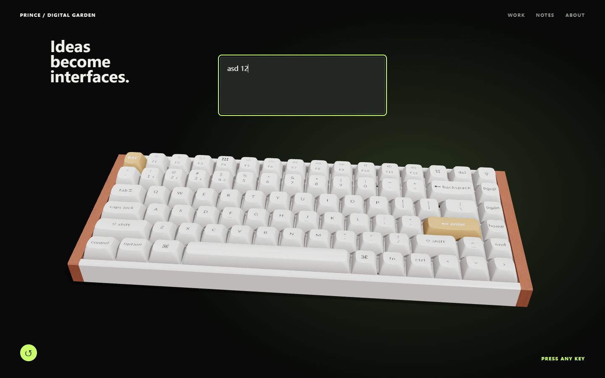
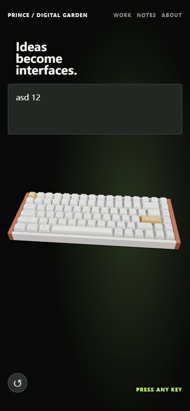

# 白金款 Keychron K2 HE 复刻验收

工作目录：`E:\project\front\prince-blog`。当前分支：`main`；本次改动未提交、未推送。

## 实现范围

- 使用项目原有 84 键布局、14 种键帽模型、轴体模型与 JSON；未新增依赖或替换模型资产。
- 按确认的白色键帽、金色 Esc/Enter、木侧板方案装配。读取 White 配色与折叠位置，并补齐参考运行时的键帽插座高度、底壳倾角和侧面螺丝。
- 字符使用与参考外观一致的 Mac 图集；实体键盘仍按 Windows `KeyboardEvent.code` 映射。修正整张图集被压缩到单键、遮罩反向、法线贴图误用造成的字符和表面异常。
- 键帽、轴芯、磁铁和弹簧共享按压状态，行程 0.25 模型单位；快速按下后立即释放仍有可见行程，长按不重复触发，组合键可分别释放，失焦清除状态。
- 保留现有主页与相机交互。竖屏自动调整取景；390px 下键盘完整可见，标题和输入框相隔 16px。
- 声音暂不加载；`key-registry.ts` 已保留 `TODO(keyboard-audio)` 的按下/抬起采样接入点。

## 自动验证

```text
node node_modules/vitest/vitest.mjs run --exclude '**/.worktrees/**'
node node_modules/typescript/bin/tsc -b --pretty false
node node_modules/vite/bin/vite.js build
git diff --check
```

- 16 个测试文件、74 项测试全部通过。
- TypeScript、生产构建和 diff 空白检查通过。
- 新增真实 R3F 帧循环测试检查键帽 Mesh 的实际高度；轴体测试检查实例矩阵、弹簧 morph、相邻键不受影响与归位。
- 新增取景投影测试覆盖 390×844、768×1024、1440×900，确认默认相机下键盘边界在画面内且轨道位置不变。
- 构建仍有现存的主包超过 500kB 提示（当前约 1,333.55kB / gzip 387.18kB）；测试中 R3F 内部使用 THREE.Clock 产生弃用提示，无测试失败。

## 本轮浏览器验证

Codex 内置浏览器，开发预览：`http://127.0.0.1:5173/`。

- 1440×900：检查可读字符、白金配色、正常闭合的外壳与木侧板；拖动查看侧面螺丝后使用复位按钮恢复默认角度。
- 390×844：完整显示键盘，文档宽度 390px，无横向溢出；标题 bottom=156px，输入框 top=172px。
- 实际发送 A/S/D/Space/1/2 按键，输入框得到 `asd 12`。
- 最终浏览器 console error 查询为空。视口测试覆盖已重置。
- 短促点按、长按/重复、组合键释放、blur 的精确位移由真实 R3F 集成测试验证；不把静态截图当作这些时序行为的证据。

本轮未重新注入浏览器 GLB 503 或禁用 WebGL，错误/重试/降级路径由已有自动测试覆盖；未重新采集 GPU draw calls。页面沿用项目背景与打光，因此不宣称与参考网页每个像素一致。




