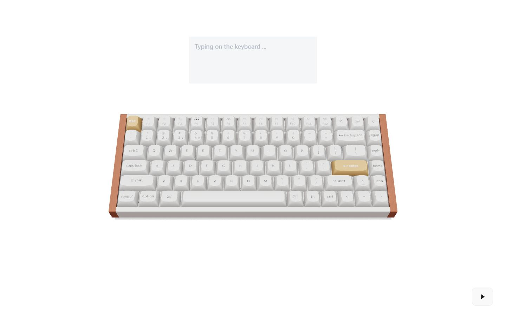
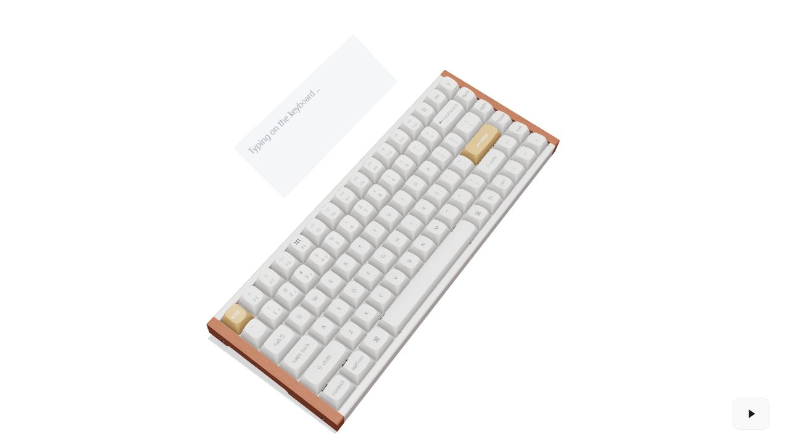
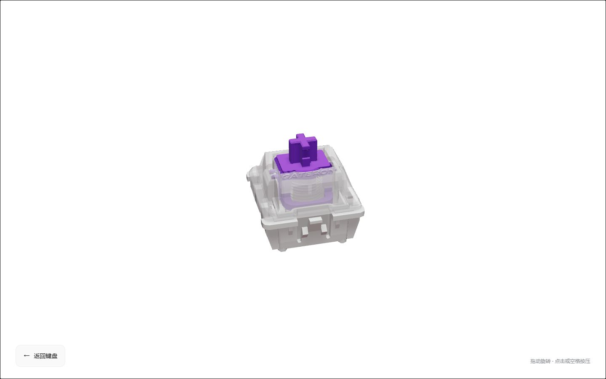
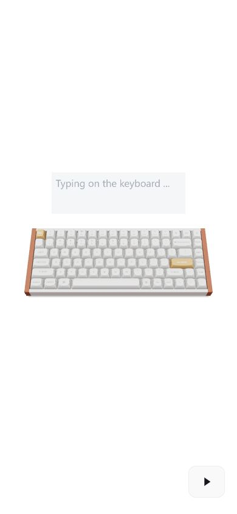
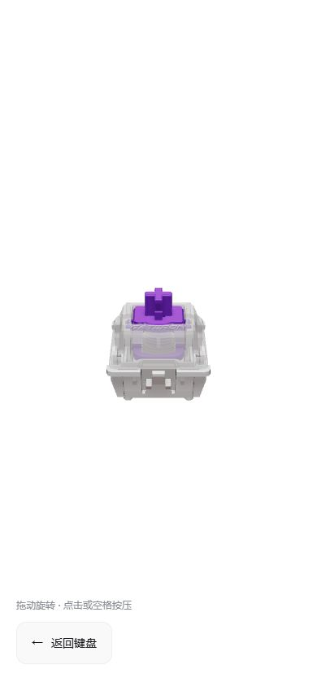
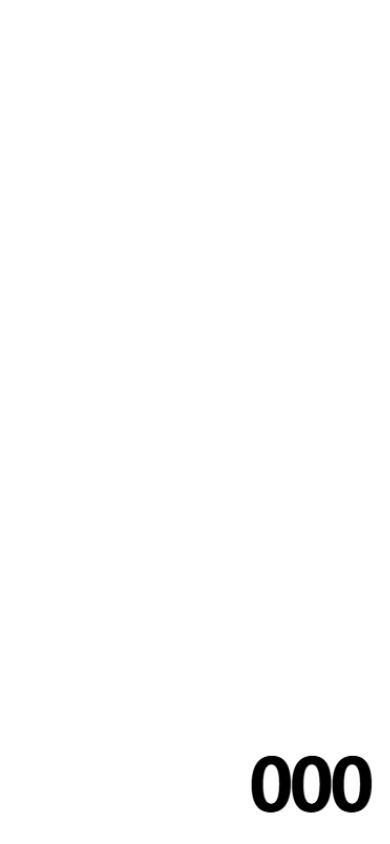

# 纯白键盘与磁轴体验验收

完成目录：`E:\project\front\prince-blog`。分支 `main`，基于用户提交 `4385685`；本轮改动未提交、未推送。沿用现有模型、贴图与 GSAP，无新增依赖。

## 已实现流程

1. 纯白数字加载页：真实资源完成数量驱动 000–099，模型和材质可用、着色器预编译完成后才显示 100。
2. 分层模型渐显，按项目 `unfoldPosition` 从爆炸态合拢；装配完成前禁用输入和入口。正常动效约 3.9 秒，减少动态效果偏好下快速进入终态。
3. 初始视角 yaw/roll 为 0，正向俯视键盘；保留拖动、Shift 拖动、滚轮与双击复位。
4. 毛玻璃输入框固定在键盘上方的三维空间，共用相机投影，随旋转改变位置和透视；使用原生 textarea 保留编辑、选择、粘贴和输入法。
5. 空白文本 Enter 不进入；有文字 Enter 或右下角三角按钮进入磁轴页。重复 Enter 和中文组词确认不会重复/误触发转场；Shift+Enter 可换行。
6. 键帽淡出，磁轴按键位错峰飞出，保留中央 J 轴；板壳退场，镜头聚焦单颗磁轴。完整转场约 4.6 秒。
7. 磁轴可拖动旋转、点击或空格按压；返回恢复完整键盘、正向相机并保留已输入的文字。

背景替换入口：`HomePage.css` 的 `TODO(keyboard-background)` 与 `--keyboard-background`。声音继续保留 `key-registry.ts` 的 `TODO(keyboard-audio)`。本版磁轴页为单颗互动展示，未加入参考视频末尾的参数排版或磁场波纹。

## 自动检查

```text
node node_modules/vitest/vitest.mjs run --exclude '**/.worktrees/**'
node node_modules/typescript/bin/tsc -b --pretty false
node node_modules/vite/bin/vite.js build
git diff --check
```

- 21 个测试文件、101 项测试通过。
- TypeScript、生产构建、diff 空白检查通过。
- 覆盖加载进度与重试隔离、装配/转场的时间顺序、入口状态限制、CSS 与 WebGL 的逐角点投影一致性、轴体世界坐标、真实 R3F 帧循环按压及实例移动。
- 覆盖长按时更新文字回调不重绑监听、不复位当前按键，以及 composing/Ctrl/Meta/Alt 不追加普通输入。
- 保留现有主包超过 500kB 的构建提示（当前约 1,344.68kB，gzip 391.35kB）；R3F 的 THREE.Clock 有弃用提示。无构建或测试失败。

## 实际浏览器检查

生产预览：`http://127.0.0.1:4173/`。开发服务器：`http://127.0.0.1:5173/`。

| 场景 | 结果 |
| --- | --- |
| 加载、展开、合拢 | 观察到数字页、分离的键帽/轴体/定位板/PCB/底壳，以及合拢后的正向键盘 |
| 拖动键盘 | 输入框同步改变位置与透视，不再固定在屏幕上 |
| 输入后 Enter | 输入 `hi` 后触发转场；观察到轴群飞出和最终单颗磁轴 |
| 清空后 Enter | 页面保持 ready，入口按钮仍存在 |
| 三角按钮 | 空内容也可进入磁轴展示，手机端已验证 |
| 返回 | 键盘各层恢复，输入 `hi` 保留，正向视角复位 |
| 磁轴交互 | 拖动后保持 switch 状态，点击/空格交互无运行错误；精确行程由 R3F 测试验证 |
| 390×844 | 文档宽 390，无横向溢出；键盘完整，输入框约 221×69px；磁轴和返回按钮完整显示 |
| 真实 GLB 503 | 临时本地代理让 Keyboard.glb 首次返回 503，显示失败与重试按钮；重试进度从 000 重启并成功装配至 ready |
| WebGL 不可用 | 同一临时代理仅在测试页面禁用 WebGL context，成功显示静态预览与降级说明 |
| Console | 正常生产页 error 查询为空；故障代理中的预期 503 错误单独验证 |

测试代理在 4174 端口运行，验收后已停止，不属于产品代码。未把背景标签页下的动画截图耗时作为性能基准；本轮没有重新记录 GPU draw calls 或 FPS。

## 截图












