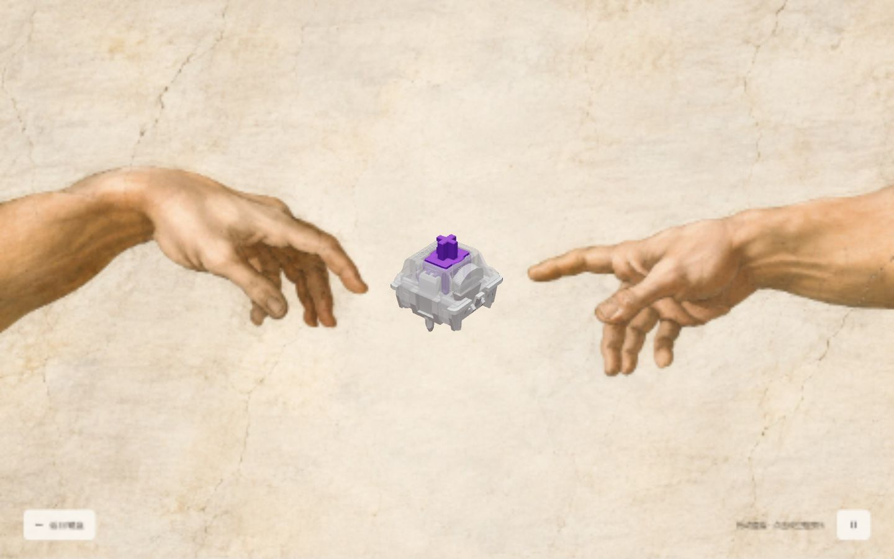
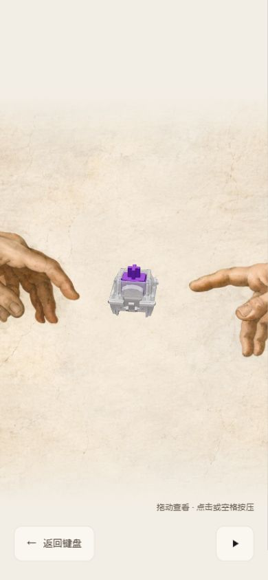
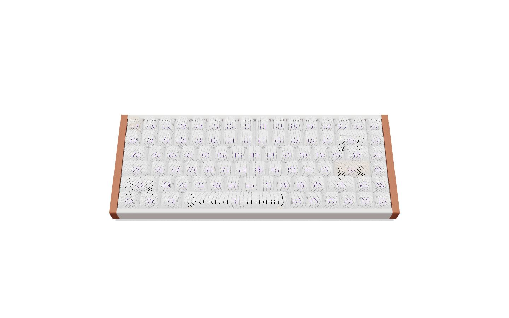
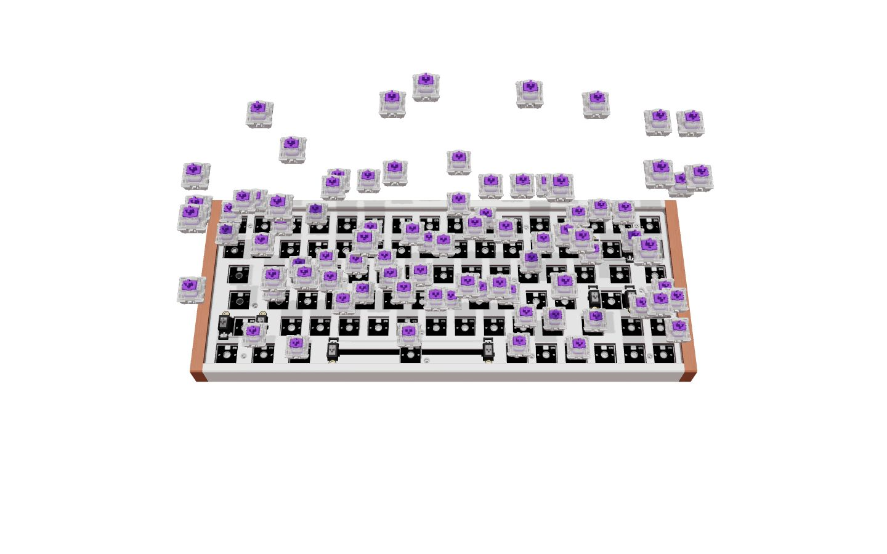
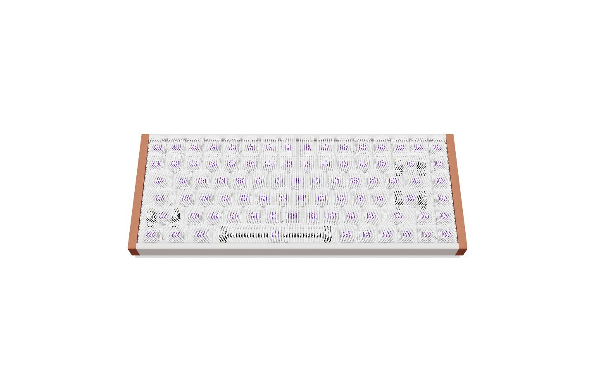

# 键帽可逆溶解与双手磁轴展示

工作目录：`E:/project/front/prince-blog`，分支 `main`，基于用户提交 `c827444`。本轮修改未提交、未推送；沿用 Three.js、GSAP 和现有模型，没有新增依赖。

## 本轮实现

- 对照 `E:/PrProject/keyboard/参考渐变按钮过渡.mp4` 提取正向、反向分镜：键帽白色细线溶解 → 轴体错峰竖直飞出 → 单轴聚焦，返回反向恢复。
- 键帽改用固定在模型上的细竖线和微网格裁切，保留常态不透明深度与字体投影；颜色和阴影使用同一个进度，修复普通透明混合导致的空壳观感。
- 增加 `returning` 阶段。约 3.5 秒返回动画只恢复底座位置、镜头、轴体和键帽；`assembly` 始终为 0，不重新展开 PCB、泡棉、电池等内部层。返回结束前禁止再次进入。
- 磁轴约每 22 秒自转一周。拖动期间暂停，释放约 0.8 秒后继续；可用按钮暂停/继续。隐藏页面和减少动态效果偏好下不自动旋转；返回时平滑恢复原朝向。
- 根据用户确认的双手特写构图，用内置 `image_gen` 重构油画参考。背景和真实三维磁轴分离；镜头距离由 10 调整到 18，让磁轴保持在指尖间清晰可见。手机使用单独的裁切尺寸。
- 保留有文字 Enter 进入、空文字按钮进入、按压、返回保留文本和原有加载/错误流程。

## 验证

```text
node node_modules/vitest/vitest.mjs run --exclude '**/.worktrees/**'
node node_modules/typescript/bin/tsc -b --pretty false
node node_modules/vite/bin/vite.js build
git diff --check
```

- 22 个测试文件 / 109 项测试通过；类型检查、生产构建与 diff 检查通过。
- 测试包含反向时序、内部层保持折叠、重复入口门控、字体 shader 与溶解叠加、色彩/阴影共享进度、Strict Mode 材质创建、J 轴交接与单次按压推进、自转阶段和角度范围。
- 浏览器实际查看 1440×900 与 390×844：正向细线渐隐、反向细线恢复、轴体落回、单轴自转、暂停后截图保持一致、拖动和手机构图；手机文档宽度为 390，无横向溢出。
- 正常页面没有控制台 error；新背景已解码，原尺寸 1672×941。
- 本轮未重新量测 FPS / GPU draw calls，也没有重新执行上一轮的 503 / no-WebGL 故障注入。
- 保留现有主包大于 500kB 的提示：JS 约 1,349.98kB，gzip 392.84kB；R3F 测试仍有 THREE.Clock 弃用提示。

生产预览：<http://127.0.0.1:4173/>。开发预览：<http://127.0.0.1:5173/>。

## 素材

背景为 AI 重新构图，未声称是网上搜集到的油画原图。网页使用 `public/images/switch-fresco/creation-hands.webp`（236,694 bytes）；PNG 原图、来源与提示词见该目录 README。没有把磁轴绘制进背景。

## 截图










